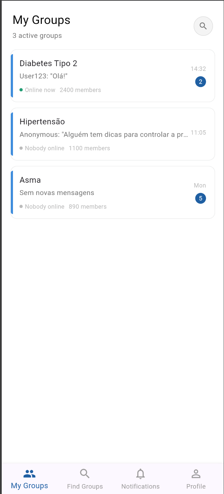
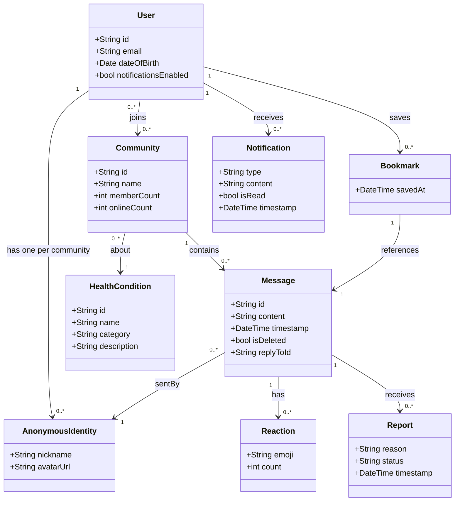
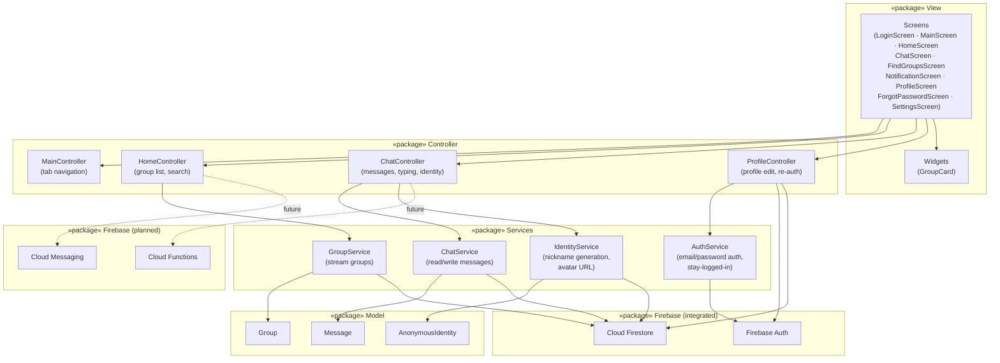
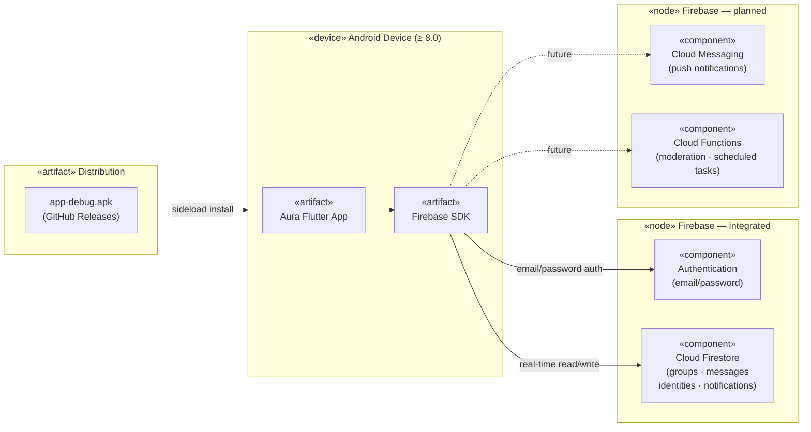
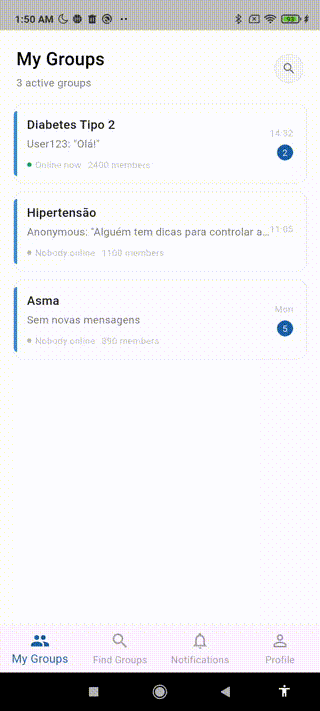
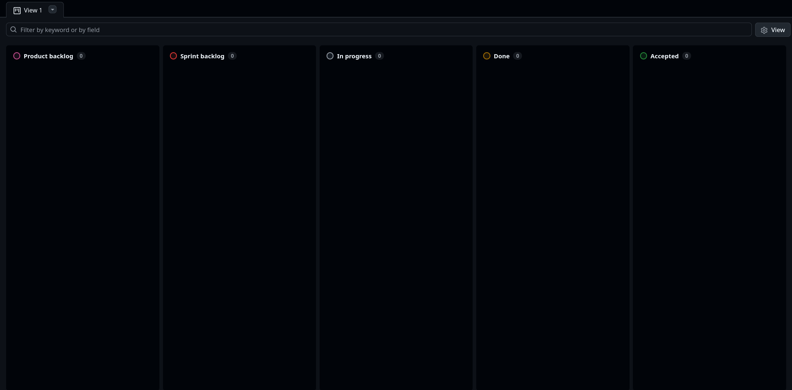
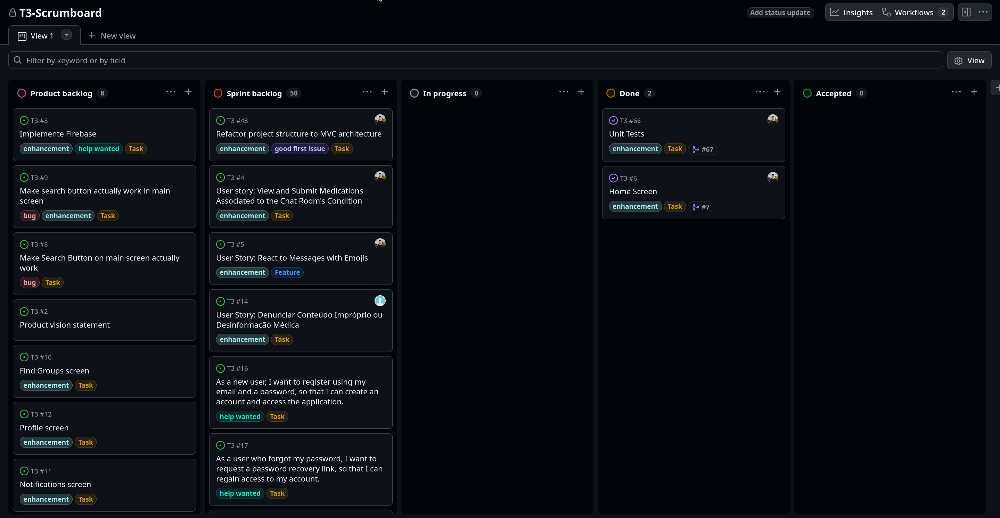
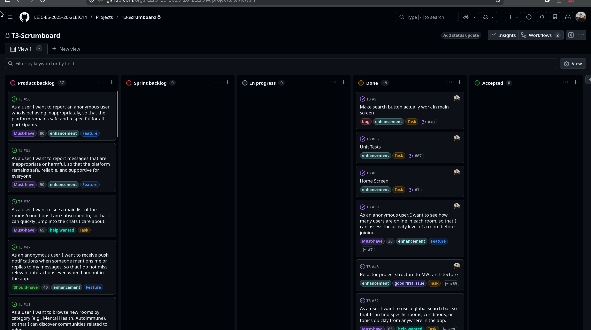

<!-- Template file for README.md for LEIC-ES-2025-26 -->

# _Aura_ Development Report

Welcome to the documentation of _Aura_!

This Software Development Report, tailored for LEIC-ES-2025-26, provides comprehensive details about _Aura_, starting from an high-level vision and going into low-level implementation decisions. 

It is organised by the following activities: 

* [Business modeling](#Business-Modelling) 
  * [Product Vision](#Product-Vision)
  * [Features and Assumptions](#Features-and-Assumptions)
* [Requirements](#Requirements)
  * [Domain model](#Domain-model)
  * [User interfaces](#User-interfaces)
  * [Requirements Validation](#Requirements-Validation)
* [Architecture and Design](#Architecture-And-Design)
  * [Logical architecture](#Logical-Architecture)
  * [Physical architecture](#Physical-Architecture)
  * [Functional prototype](#Functional-Prototype)
* [Project management](#Project-Management)
  * [Sprint 0](#Sprint-0)
  * [Sprint 1](#Sprint-1)
  * [Sprint 2](#Sprint-2)
  * [Sprint 3](#Sprint-3)
  * [Final Release](#Final-Release)

Contributions are expected to be made exclusively by the initial team, but we may open them to the community, after the course, in all areas and topics: requirements, technologies, development, experimentation, testing, etc.

Please contact us!

Thank you!

* Bruno da Fonseca Nicolau Costa Dias - up202405613@up.pt
* Carolina Oliveira Dias - up202406310@up.pt
* Daniel Morais Rama - up202409357@up.pt
* Francisco Almeida Henriques dos Santos Poeira - up202406330@up.pt
* Pedro Oliveira Soares Lopes - up202405618@up.pt

---
## Business Modelling

Business modeling in software development involves defining the product's vision, understanding market needs, aligning features with user expectations, and setting the groundwork for strategic planning and execution.

### Product Vision

<!-- 
Start by defining a clear and concise product vision for your app, to help members of the team, contributors, and users into focusing their often disparate views into a concise, visual, and short textual form. 

The vision should provide a "high concept" of the product for marketers, developers, and managers.

A product vision describes the essential of the product and sets the direction to where a product is headed, and what the product will deliver in the future. 

**We favor a catchy and concise statement, ideally one sentence.**

We suggest you use the product vision template described in the following link:
* [How To Create A Convincing Product Vision To Guide Your Team, by uxstudioteam.com](https://uxstudioteam.com/ux-blog/product-vision/)

To learn more about how to write a good product vision, please read:
* [Vision, by scrumbook.org](http://scrumbook.org/value-stream/vision.html)
* [Product Management: Product Vision, by ProductPlan](https://www.productplan.com/glossary/product-vision/)
* [20 Inspiring Vision Statement Examples (2019 Updated), by lifehack.org](https://www.lifehack.org/articles/work/20-sample-vision-statement-for-the-new-startup.html)
-->
| | |
|---|---|
| **Vision** | Empower people living with chronic or rare health conditions to find their community anonymously — sharing experiences, insights, and support with others who truly understand. |
| **Target group** | People diagnosed with chronic or rare health conditions (e.g. diabetes, fibromyalgia, MS) who feel isolated and lack a safe space to talk openly about their experiences. |
| **Needs** | A stigma-free space to connect with peers who share the same condition — without fear of judgment, loss of privacy, or exposure of personal identity. |
| **Product** | Anonymous mobile app with condition-specific communities, real-time group chat, peer wellbeing sharing (with medical disclaimers), message reactions, and content moderation. |
| **Business goals** | Demonstrate viability of an anonymous peer-support platform as a university project. Validate demand, gather user feedback, and build a working MVP with a real Firebase backend. |

### Features and Assumptions
<!-- 
Indicate an  initial/tentative list of high-level features - high-level capabilities or desired services of the system that are necessary to deliver benefits to the users.
 - Feature XPTO - a few words to briefly describe the feature
 - Feature ABCD - ...
...

Optionally, indicate an initial/tentative list of assumptions that you are doing about the app and dependencies of the app to other systems.
-->

### Features:

#### 1. Authentication and account management
- Registration with e-mail and password
- Password recovery
- Private profile editing (name, date of birth, e-mail)
- Account privacy settings
- Notification management (push and e-mail)
- Account deletion and data export (GDPR)
- Terms of service and privacy policy (acceptance)

#### 2. Onboarding and health selection
- Initial health/interests questionnaire
- Health condition search and selection (catalogue)
- Suggest new conditions (form)
- Manage list of followed conditions
- Define experience level with the condition (patient/doctor)

#### 3. Anonymity system
- Automatic anonymous avatar generation
- Random anonymous nickname generation (e.g. *CalmWolf*)
- Option to generate a new anonymous identity (reset)
- Identity isolation (a different nickname per room/condition)
- User metadata concealment (registration date, location, IP)

#### 4. Directory and navigation
- Main list of subscribed rooms/conditions
- Explore new rooms by category (mental health, autoimmune, chronic, etc.)
- Sub-rooms or specific topics (e.g. Diabetes > Insulin Pumps)
- Global search bar (rooms, conditions, topics)
- Online user count per room

#### 5. Chat and interaction
- Real-time text chat (public within rooms)
- Reply to specific messages (threads)
- Anonymous user mentions (@nickname)
- Typing indicator
- Empathetic emoji reactions (hug, I understand, stay strong, etc.)
- Link sharing with preview (and automatic medical disclaimer warning)
- Anonymous polls within rooms
- Save messages (bookmarks/favourites) in a private area
- Message history search within a room
- Pinned messages at the top of the chat

#### 6. Safety and moderation
- Mandatory medical disclaimer acceptance on room entry
- Global SOS button (link to local support and emergency lines)
- Report message (spam, misinformation, bullying, risk to life)
- Report anonymous user
- Block/mute anonymous user (hide their messages)
- Automatic profanity and hate speech filter
- Automatic personal data sharing filter (phone numbers, e-mails)
- Detection and blocking of prescription medication names (illegal sales)
- Shadowban system for offending users
- Moderator status (verified medical professionals only)

#### 7. Engagement and community
- Karma/thanks system (give anonymous kudos for good advice)
- Welcome bot in rooms

#### 8. Notifications and accessibility
- Push notifications for replies and mentions
- Activity notifications for saved topics
- Do not disturb mode / silence schedules
- Font size adjustment (accessibility)
- Screen reader support (VoiceOver/TalkBack)

#### 9. Future features
- Live Q&A sessions with invited doctors/specialists (they are real, users remain anonymous)
- Temporary private rooms created by users
- In-app donations to keep the project running

### Assumptions

- Users have an Android device running Android 8.0 or above with a stable internet connection
- Users are willing to register with a real e-mail and password for account recovery purposes
- Firebase Authentication (e-mail/password) is sufficient for account management in the MVP
- Auto-generated anonymous nicknames and avatars are accepted by users as their in-room identity
- A single anonymous identity per room is enough — users do not need cross-room identity persistence
- Medical disclaimers displayed at room entry are sufficient to mitigate liability around shared health content
- The health condition catalogue is manually curated by the team for the MVP — no external medical database integration
- Content moderation in the MVP is semi-manual (automated filters + user reports reviewed by the team)
- Push notifications are delivered via Firebase Cloud Messaging (FCM) and require user permission on device
- GDPR compliance is limited to account deletion and basic data export in the MVP — full compliance is a post-MVP concern
- The SOS button links to static, pre-defined crisis lines — no dynamic geolocation-based lookup in the MVP
- Live Q&A sessions, private rooms, and donations are out of scope for the MVP and treated as future features
- The app targets Android only — iOS support is deferred

## Requirements

### User Stories

The user stories for this project are managed and tracked in our [GitHub Projects board](https://github.com/orgs/LEIC-ES-2025-26-2LEIC14/projects/3/views/1).

### User Interface

#### Home screen

  

The home screen displays the list of health condition communities the user has joined, showing the group name, description, number of online members, and an unread message badge. Users can tap a group to enter the chat room or navigate to other sections via the bottom tab bar.

#### Navigation
The app navigation is organised around a bottom tab bar with four main sections:
- **Communities** — list of joined groups (home screen)
- **Find groups** — explore and join new condition-specific communities
- **Notifications** — alerts for replies, mentions and activity
- **Profile** — account settings and anonymous identity management

### Domain model

The domain model captures the core concepts of Aura and their relationships. The central concern is preserving anonymity: a **User** has a real account but interacts inside each **Community** through a separate **AnonymousIdentity**, so their real identity is never exposed to other members.

**Domain concepts:**

- **User** — A registered account identified by email and password. Personal data is kept private and never shared with other users.
- **AnonymousIdentity** — A randomly generated nickname and avatar assigned to a User for a specific Community. Each Community gives the User a different identity, ensuring cross-room anonymity.
- **HealthCondition** — A medical condition (e.g. Diabetes, Fibromyalgia) used to categorise Communities. Curated by the team for the MVP.
- **Community** — A real-time chat room built around a single HealthCondition. Tracks member count and current online count.
- **Message** — A text post sent by an AnonymousIdentity inside a Community. Supports replies (via `replyToId`) and soft deletion.
- **Reaction** — An empathetic emoji response (e.g. hug, "I understand") attached to a Message.
- **Report** — A moderation flag raised by any member on a Message, stating a reason (spam, misinformation, bullying, etc.) and tracked through a review status.
- **Notification** — An in-app alert sent to a User for events such as replies to their messages or mentions of their anonymous nickname.
- **Bookmark** — A private reference saved by a User to a Message they want to revisit later.

### Requirements Validation

To validate the product backlog and core assumptions, we ran an anonymous online survey (Google Forms) with **11 respondents** — people who have experience managing a chronic or rare health condition. The survey covered sharing habits, fears, desired features, and deal-breakers.

---

#### Q1 — Do you currently share your health experiences online?
| Answer | % |
|---|---|
| No — fear of exposure or judgment | **63.6%** |
| Yes — open social networks (Facebook, Instagram) | 9.1% |
| Yes — specific forums or private groups | 9.1% |
| No — no interest | 9.1% |
| No — doesn't apply to me | 9.1% |
| No — see no reason to | 9.1% |

**Insight:** Nearly two thirds of respondents don't share online due to fear of exposure. This directly validates anonymity as the core differentiator of our App — not a nice-to-have, but the primary barrier to entry for this audience.

---

#### Q2 — What is your biggest fear when talking about your health condition online?
| Answer | % |
|---|---|
| Being identified by acquaintances or employer | **36.4%** |
| Receiving wrong or dangerous medical advice | **27.3%** |
| Being a victim of bullying or spam | 9.1% |
| Exposing myself online | 9.1% |
| No fears | 9.1% |

**Insight:** The top two fears — identity exposure and medical misinformation — map directly to two of our planned feature sets: the anonymity system and moderation/expert validation. Both need to be prominent from day one.

---

#### Q3 — Which features would give you the most confidence to use the app? *(select up to 2)*
| Feature | Votes |
|---|---|
| Medication tips validated by medical experts | **9 (81.8%)** |
| Simple tools to report medical misinformation | 3 (27.3%) |
| System that automatically prevents sharing of personal data | 3 (27.3%) |
| Immediate access to local emergency lines | 3 (27.3%) |
| Quick reactions (Hug / Stay Strong) without typing | 2 (18.2%) |
| User reliability shown through kudos received | 0 (0%) |

**Insight:** Expert validation of medical content is overwhelmingly the most trust-building feature (81.8%). The karma/kudos system scored 0% — users don't associate it with trustworthiness. Emergency line access and automatic data-sharing prevention scored equally, suggesting safety features are valued as a group.

---

#### Q4 — How would you like to show gratitude for useful advice without writing much?
| Answer | % |
|---|---|
| Both — reactions AND a kudos button | **45.5%** |
| Kudos button that increases the other's reputation | 27.3% |
| Quick reactions (Hug, Heart, "I'm here") | 27.3% |

**Insight:** The majority want both systems. We should implement quick reactions (already planned) and keep the kudos/karma feature — but reframe it as an expression of gratitude rather than a trust/reliability signal, since Q3 showed it doesn't convey reliability to users.

---

#### Q5 — What would make you abandon Aura immediately?
| Answer | % |
|---|---|
| Feeling there are trolls or people mocking the situation | **45.5%** |
| Too much uncorrected medical misinformation | **36.4%** |
| Receiving unsolicited private messages | 18.2% |

**Insight:** Trolling and misinformation are the two biggest churn risks. The shadowban system and moderation pipeline must be implemented before the app goes public. Unsolicited private messages are also a significant concern — direct messaging between users should be blocked or heavily restricted in the MVP.

---

#### Q6 — Open question: one thing to make your journey lighter
Selected responses (filtered for relevance):
- *"Conseguir ver a experiência de outros com a minha condição e como a superam"* — Being able to see how others with the same condition cope and overcome it
- *"Respeito"* — Respect
- *"Seriedade"* — Seriousness (the app must feel safe and earnest, not casual)
- *"amigos"* — Friends / community connection

**Insight:** Users are looking for genuine peer experiences — not advice per se, but solidarity and lived knowledge. This reinforces the community/room structure over a Q&A format.

---

#### Backlog impact

Based on the survey findings, the following changes were made to the product backlog:

| Change | Reason |
|---|---|
| **Elevated priority** — Verified moderator / expert badge system | 81.8% say expert validation is the top trust factor |
| **Elevated priority** — Troll detection and shadowban system | 45.5% would abandon the app due to trolls |
| **Elevated priority** — Medical misinformation reporting | 36.4% would abandon the app due to uncorrected misinformation |
| **Added / confirmed** — Both reactions AND kudos (not either/or) | 45.5% want both; kudos reframed as gratitude, not reliability |
| **Added** — Block or restrict unsolicited private messages in MVP | 18.2% churn risk; DMs undermine anonymity and safety |
| **Confirmed** — Anonymity system as Sprint 1 priority | 63.6% won't share health info without guaranteed anonymity |

## Architecture and Design
<!--
The architecture of a software system encompasses the set of key decisions about its organization. 

A well written architecture document is brief and reduces the amount of time it takes new programmers to a project to understand the code to feel able to make modifications and enhancements.

To document the architecture requires describing the decomposition of the system in their parts (high-level components) and the key behaviors and collaborations between them. 

In this section you should start by briefly describing the components of the project and their interrelations. You should describe how you solved typical problems you may have encountered, pointing to well-known architectural and design patterns, if applicable.
-->

### Logical architecture

Aura follows the **MVC (Model–View–Controller)** pattern extended with a **Services** layer that isolates all Firebase calls from business logic. Controllers use Flutter's `ChangeNotifier` for reactive state management; screens rebuild automatically via `ListenableBuilder`.

**Package descriptions:**

- **View** (`lib/screens/`, `lib/widgets/`) — Flutter screens and reusable widgets. Screens observe controllers via `ListenableBuilder` and forward user actions to the appropriate controller. Widgets are stateless, presentation-only components.
- **Controller** (`lib/controllers/`) — `ChangeNotifier` classes that own application state and business logic. `MainController` manages bottom-tab navigation; `HomeController` owns the group list and search; `ChatController` manages messages, the typing indicator, and anonymous identity resolution; `ProfileController` handles profile viewing and credential updates.
- **Model** (`lib/models/`) — Pure Dart data classes (`Group`, `Message`, `AnonymousIdentity`) with no framework dependencies. Define the shape of domain data consumed by controllers and rendered by views.
- **Services** (`lib/services/`) — Thin adapters over Firebase. Each service has a single responsibility: `AuthService` for email/password auth and session persistence; `ChatService` for Firestore message reads and writes; `GroupService` for streaming the group list; `IdentityService` for nickname generation and avatar URL derivation. Services are injected into controllers, making controllers testable without Firebase.
- **Firebase (integrated)** — Firebase Authentication (email/password) and Cloud Firestore are live and used by all service classes. Firestore security rules enforce that messages can only be sent under a user's own anonymous identity.
- **Firebase (planned)** — Cloud Messaging (push notifications) and Cloud Functions (server-side moderation, scheduled tasks) are not yet integrated.

### Physical architecture

Aura is a Flutter mobile app distributed as an `.apk` and backed by Firebase, which eliminates the need to maintain a dedicated backend server.

**Node and artifact descriptions:**

- **Android Device** — The user's smartphone (Android 8.0+). Runs the compiled Flutter app and the Firebase SDK, which handles all communication with the cloud platform.
- **Distribution** — The release `.apk` is published on GitHub Releases. Users sideload it by enabling *Install from unknown sources*. Google Play distribution is planned for a later milestone.
- **Firebase Authentication** — Manages user accounts (email/password). Integrates natively with Firestore security rules, removing the need for a custom auth server. Live since Sprint 1.
- **Cloud Firestore** — NoSQL real-time database storing groups, messages, anonymous identities, typing state, and notifications. Real-time listeners drive live chat and typing indicator updates without polling. Live since Sprint 1.
- **Firebase Cloud Messaging (FCM)** — Will deliver push notifications to devices for mentions, replies, and moderation events. Package is installed but integration is planned for a future sprint.
- **Cloud Functions** — Serverless functions triggered by Firestore events, planned for server-side moderation filters (profanity, personal data detection) and scheduled tasks (shadowban expiry, welcome bot). Chosen to keep sensitive logic off the client.

### Functional prototype

The Sprint 0 prototype implements the **Communities home screen** — the most characteristic screen of Aura, showing the user's joined health condition groups with live status indicators and unread message badges. This demonstrates the core navigation structure and the main differentiating UI of the app.

  

**What is demonstrated:**
- Bottom tab bar navigation across all 4 sections (Communities, Find Groups, Notifications, Profile)
- Group list with condition name, last message preview, member count, online status indicator, and unread badge
- Unread badge logic: hidden at 0, exact count up to 99, "99+" cap above that
- Empty state UI with CTA to find a community

The prototype is available as a downloadable `.apk` in the [v0 release](https://github.com/LEIC-ES-2025-26-2LEIC14/T3/releases/tag/v0).

## Project management
<!--
Software project management is the art and science of planning and leading software projects, in which they are planned, implemented, monitored and controlled.

In the context of ESOF, we recommend each team to adopt a set of project management practices and tools capable of registering tasks, assigning tasks to team members, adding estimations to tasks, monitor tasks progress, and therefore being able to track their projects.

Common practices of managing agile software development with Scrum are: backlog management, release management, estimation, Sprint planning, Sprint development, acceptance tests, and Sprint retrospectives.

You can find below information and references related with the project management: 

* Backlog management: Product backlog and Sprint backlog in a [Github Projects board](https://github.com/orgs/LEIC-ES-2025-26-2LEIC14/projects/3/views/1);
* Release management: [v0](#), v1, v2, v3, ...;
* Sprint planning and retrospectives: 
  * plans: screenshots of Github Projects board at begin and end of each Sprint;
  * retrospectives: meeting notes in a document in the repository, addressing the following questions:
    * Did well: things we did well and should continue;
    * Do differently: things we should do differently and how;
    * Puzzles: things we don’t know yet if they are right or wrong;
    * list of a few improvements to implement next Sprint;

-->

### Sprint 0

#### Board screenshots

**Beginning of sprint:**

  

**End of sprint:**

  

#### Retrospective
**Did well:**
- Defined a clear and shared product vision early on
- Set up the GitHub repository, Projects board and initial backlog
- Divided tasks evenly across the team
- Built the home screen UI with key features (group list, unread badge, online indicator)

**Do differently:**
- Start the sprint earlier to avoid time pressure towards the end

### Sprint 1

#### What was delivered

Sprint 1 turned the static prototype into a fully connected app with a real Firebase backend. Every major screen is now functional end-to-end.

**Authentication**
- Login screen with email/password, registration, and "stay logged in" preference (persisted via shared preferences)
- Password strength indicator and email format validation
- Forgot password — sends a Firebase password-reset email; prevents double-send

**Firebase integration**
- Cloud Firestore as the real-time database for groups, messages, and notifications
- Firebase Authentication (email/password) wired to an `AuthGate` that routes users to the app or login screen
- Firestore security rules for all collections (groups, messages, notifications, user identities)

**Chat**
- Real-time Firestore-backed chat with a `Message` model
- Reply-to-message support — tapping a message quotes it in the reply bubble
- Typing indicator — shows when another member is composing
- Messages displayed in correct chronological order; 1000-character cap

**Anonymous identity**
- Unique nickname generated per user per group (adjective + noun + number format)
- Collision-safe: retries until a unique name is found in Firestore
- Avatar URL derived without leaking the user's IP
- Identity stored in Firestore and attached to every outgoing message

**Find Groups screen**
- Browse available communities from Firestore
- Search bar filters groups by name in real time

**Profile management**
- Profile screen showing display name, email, and joined groups
- Edit email and password with Firebase re-authentication guard
- Minimum 8-character password enforcement
- Edit button hidden for auth providers that do not support credential updates

**Notifications**
- Notification screen listing alerts with per-type icons (message, mention, etc.)
- Read/unread state stored and updated in Firestore
- Notifications created asynchronously when a message is sent to a group

**Tests**
- Unit tests for all controllers (`HomeController`, `ChatController`, `ProfileController`, `MainController`)
- Unit tests for all services (`AuthService`, `ChatService`, `GroupService`, `IdentityService`)
- Widget tests for `GroupCard` and navigation
- Integration tests covering the auth flow, chat flow, and profile flow

#### Board screenshots

**Beginning of sprint:**

*(screenshot to be added)*

**End of sprint:**

  

#### Retrospective

**Did well:**
- Delivered all planned Sprint 1 user stories
- Established a working Firebase backend (Auth, Firestore, rules) shared across all features
- Kept the MVC structure consistent across new screens and controllers
- Wrote unit and integration tests alongside feature work

**Do differently:**
- Coordinate Firestore rule changes as a team to avoid merge conflicts
- Define shared data contracts (Firestore document schemas) before starting parallel features

**Puzzles:**
- Whether to keep anonymous identity regeneration per-session or per-message

### Sprint 2

### Sprint 3

### Final Release
